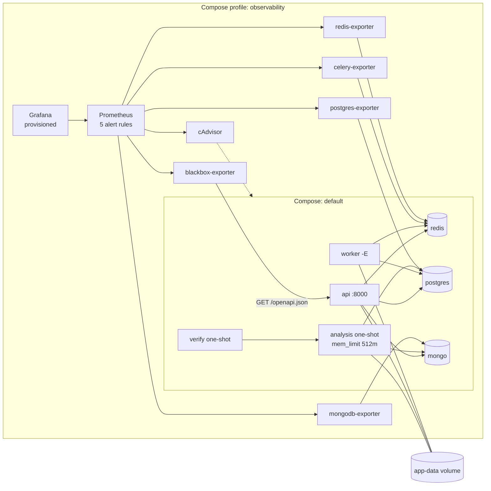

# Architecture and decisions

Target cloud: **Azure** (current provider). Application code stays provider-neutral; Azure appears only in Terraform.

## Decisions

**One shared image, three commands.** The API, worker and analysis use one non-root `python:3.11-slim` image. It's simple and guarantees the same dependencies everywhere. *Alternative:* per-step images. *Trade-off:* separate images are smaller and allow per-step pinning, but need more builds; not worth it at this size.

**Data in a named volume; model selected by `MODEL_PATH`.** Fixtures are generated inside the container, which avoids the absolute host paths in `manifest.json`. `.dockerignore` keeps `data/`, `.env` and `.git` out of the build. `run_local.py` takes `MODEL_PATH`, so a different model needs no rebuild. *Alternative:* bind-mount `./data`. *Trade-off:* easier inspection from the host, but the paths diverge and Docker creates missing bind sources owned by root.

**The verifier owns the expected digest and the timeout.** The expected SHA-256 is supplied or hashed from the selected model *before* the run, never taken from the output rows. The run starts in its own process group, so a timeout kills the runner and its current step.

**Monitoring from outside the application.** The API has no `/metrics` endpoint, so the stack uses only off-the-shelf components:
- a blackbox probe for API availability and latency
- the Celery exporter for queue depth and workers (the worker only needs `-E`)
- cAdvisor for per-container CPU and memory
- one exporter per database

No application code changed. *Alternative:* instrument FastAPI and Celery with a Prometheus client. *Trade-off:* that gives per-endpoint latency and error rates, which a probe can't see, but it puts the change in Dev's code. It's the right next step once Dev owns the metrics.

**The alert pages on user impact, not on causes.** `ExportQueueStuck` fires when exports are queued and no worker is alive: users are waiting for reports that will never come. `ApiDown` and `DependencyDown` cover the other user-facing failures. `ScrapeTargetDown` and `AnalysisMemoryNearLimit` are tickets, not pages.

**Batch-job memory is measured, not read from the dashboard.** The analysis run lasts about 7 s. With 5 s scrapes, Prometheus saw a 5 MiB peak, while the container's cgroup `memory.peak` was 254 MiB. The 512 MiB limit is based on the cgroup figure. An OOM kill shows up as exit 137 and a failed verification. *Alternative:* Pushgateway with the job pushing its own peak. *Trade-off:* exact numbers, but the job then depends on monitoring.

**Monitoring is opt-in.** The `observability` Compose profile keeps `docker compose up` fast for Dev and CI. All images are pinned.

**Azure Blob with lifecycle management.** Raw images, masks and model artifacts get separate containers. Anonymous access and shared keys are off; access is Entra ID only. Versioning is on, with 7-day soft delete, and the model container has no expiry rule. *Alternative:* MinIO on AKS. *Trade-off:* fully portable, but we'd operate durability ourselves. Blob behind configured URLs keeps the code neutral.

## Terraform storage mapping

| Resource | Holds | Lifecycle rule |
|---|---|---|
| `azurerm_storage_container.this["raw"]` → `raw-images` | Raw camera images | Cool after 7 days, delete after 30 (incl. old versions) |
| `azurerm_storage_container.this["masks"]` → `masks` | Masks | Delete after 30 days |
| `azurerm_storage_container.this["models"]` → `model-artifacts` | Model artifacts | None: excluded from expiration |
| `azurerm_storage_account.data` | All of the above | Private, shared keys off, TLS 1.2, versioning, 7-day soft delete |

**Minimum duration and timing.** Azure cool storage bills a 30-day minimum. Raw images moved to cool on day 7 and deleted on day 30 spend 23 days in cool, so each one incurs an early-deletion charge for about 7 days. Lifecycle policies run roughly once a day, so actions can lag by 24–48 hours, and the rules count days since last modification. (AWS can't move objects to Standard-IA until day 30, so this policy wouldn't port as written.)

**Production state and credentials.** Use an `azurerm` backend in a separate, locked-down storage account (blob-lease locking), with OIDC from CI and no stored keys. Locally there's no backend.

**What gets deleted.** Lifecycle rules permanently delete raw images and masks, including old versions, after 30 days. `terraform destroy` deletes everything, **including model artifacts**. Add `prevent_destroy` or a resource lock before any real deployment.

**External dependencies:** an Azure subscription, permission to create resources and data-plane role assignments (`storage_use_azuread`), and internet access to download the provider.
